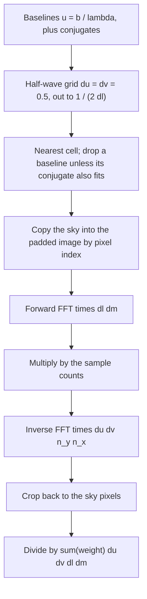
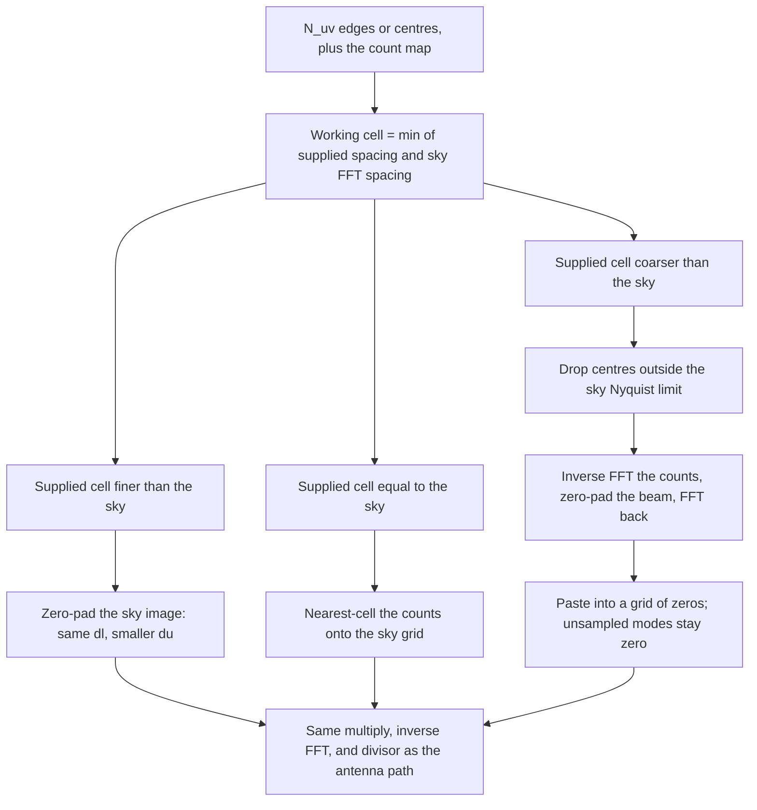
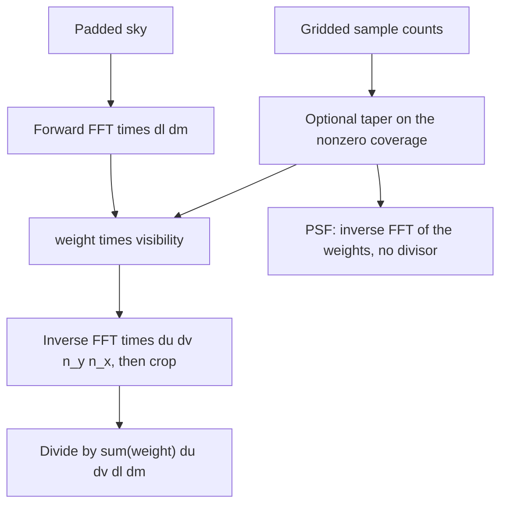

# How `fast_interferometer` pads and transforms

The UV weight is the sample count in each cell. After the weights are on the working grid, both paths image the same way. An optional taper multiplies those weights. The forward transform of the sky is multiplied by `dl dm`. The inverse transform is multiplied by `du dv n_y n_x`. The dirty map then divides by

```text
sum(weight) * du * dv * dl * dm
```

`get_psf` is the inverse transform of the weights and is not divided by that factor. `count_map` stays the raw sample counts; a taper does not change it.

The sky pixel size is `dl = sin(theta_x) / x_npix` and `dm = sin(theta_y) / y_npix`. The sky's own FFT spacing is `du_sky = 1 / (x_npix dl)`, and the sky Nyquist limit is `1 / (2 dl)`.

## Antenna path

Baselines are `u = b / lambda`, and each baseline is stored with its conjugate. Autocorrelations are omitted. The working cell is half a wavelength, `du = dv = 0.5`, and the axis stops at the sky Nyquist limit. The padded image has `n_pad = round(1 / (0.5 dl))` pixels, so its FFT spacing is 0.5 and `u = 0` is a cell centre.

A baseline is kept only when it and its conjugate both land in a cell inside that limit. The landing is the nearest cell. The weight in a cell is the number of baselines that landed there.

The sky is copied into that padded image by pixel index. There is no resampling. Pixels outside the original sky are zero.



## `N_uv` path

The supplied arrays are bin edges when the count map is one cell shorter on each axis, and bin centres otherwise. `du` and `dv` are the median spacings of those edges.

The working cell is the finer of the supplied spacing and the sky FFT spacing. The axis stops at the sky Nyquist limit, so the returned image is always the original sky shape. Counts whose centres fall outside that limit are dropped before they are placed.



**Finer than the sky.** The sky image is zero-padded. The pixel size `dl` stays the same, the image gets longer, and the FFT spacing shrinks to the supplied `du`. No count values are interpolated.

**Equal to the sky.** Each count is added into the nearest working cell. This is the path for a count map that is already on the sky FFT grid, including a weight of 1 in every sky mode.

**Coarser than the sky.** The count array is transformed as an image, not assigned to nearest cells. Nearest-cell assignment of samples that sit halfway between coarse cells merges neighbours and leaves a comb, and the transform of that comb is a repeated beam. Instead the counts are inverse-transformed, the beam is zero-padded so the cell matches the sky spacing while the original UV extent is kept, and the result is transformed back. That block is pasted into a grid of zeros the size of the sky UV plane. Sky modes outside the original coverage are multiplied by zero.

## Shared imaging



A taper is applied to a copy of the weights after gridding. `count_map` is unchanged, and with `redundancy=True` the noise draw still uses those raw counts.
